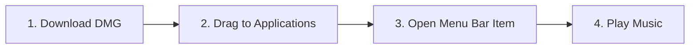

# Valdi — Animated Lyrics Visualizer for macOS

> **Valdi** is a native macOS menu bar visualizer (macOS 14+) that displays animated lyrics while **Spotify** or **Apple Music** plays. It uses synchronized lyric timestamps when available and estimates word timing when only line timestamps are provided.

---

## ✦ Core Features

- **Menu Bar Exclusive (`LSUIElement`):** Lives solely in the macOS menu bar. No dock clutter, no standard windows.
- **Smooth Playback Synchronization:** Combines player notifications and AppleScript polling with a 60 FPS playback-position interpolation loop.
- **Word-Level Lyrics:** Uses enhanced LRC word timestamps when available and estimates word pacing from line-level LRC timestamps otherwise; estimated timings are not guaranteed to match the vocal precisely.
- **Metal 3.0 Optical Shaders:** Native MSL stitchable shaders powering real convex lens glass refraction and chromatic dispersion.
- **770+ Visual Token Dictionary:** Contextual SF Symbols and emojis pop in dynamically beside lyrics matching celestial, romance, energy, weather, music, motion, and lifestyle vocabulary.
- **Dynamic Album Art Palette Engine:** Samples vibrant, high-contrast tri-color palettes from album artwork in real time.
- **Display Sleep Prevention:** Requests a display-sleep assertion while the visualizer is shown during playback.
- **Lumn Companion Lighting:** Dynamic peripheral screen halo that pulses with lyric word timing and an estimated beat.

---

## ✦ 4-Step Setup Flow



1. **Download DMG:** Grab the release `Valdi-1.0.0.dmg`.
2. **Drag to Applications:** Drop the `Valdi.app` icon into the `/Applications` symlink.
3. **Open Menu Bar Item:** Launch Valdi; the waveform icon appears in the top menu bar. Grant AppleScript automation permissions when prompted for Spotify and Apple Music.
4. **Play Music:** Hit play in Spotify or Apple Music. Valdi fetches synced lyrics from LRCLIB and displays the selected visualizer. Tracks without word-level timestamps use estimated word timing. macOS controls what third-party apps can display over the secure lock screen, so lock-screen overlays may vary by system version and security state.

---

## ✦ The Four Display Styles

| Style | Rendering Pipeline | Visual Behavior |
| :--- | :--- | :--- |
| **Ship** | SwiftUI 3D Matrix (`rotation3DEffect`, depth offsets) | Words stack into a dynamic dimensional wall that drifts through 3D space with a subtle starfield. |
| **Fisheye** | Metal Stitchable Lens Shader (`fisheyeLensDistortion`) | A convex stack rendered under an optical glass hemisphere; the active word sits closest to the glass with maximum magnification. |
| **Fisheye Visual** | Metal Shader + SF Symbol Engine | Merges the optical convex lens refraction with contextual SF Symbols and emojis. |
| **Visual** | Kinetic Typography + 770+ Word Mapping | Contextual SF Symbols and emojis burst in beside words as they are vocalized, with progressive syllable fills. |

---

## ✦ Technical Architecture

```
Valdi/
├── Package.swift                    # Swift Package Manager manifest (macOS 14+)
├── Sources/Valdi/
│   ├── App/
│   │   ├── ValdiApp.swift           # @main SwiftUI App with MenuBarExtra (.window)
│   │   └── AppDelegate.swift        # NSApplicationDelegate, accessory policy, state binding
│   ├── Models/
│   │   ├── DisplayStyle.swift       # Ship, Fisheye, Fisheye Visual, Visual enums
│   │   ├── DisplayBehavior.swift    # LockScreenOnly, AlwaysOn, UnlockedOnly
│   │   ├── Track.swift              # Real-time player metadata & playback state
│   │   ├── Lyrics.swift             # WordLyric, LineLyric, SyncedSongLyrics models
│   │   └── AppTheme.swift           # Color palette persistence & hex serialization
│   ├── Services/
│   │   ├── MusicIntegrationService.swift # Spotify & Music AppleScript/Distributed observers
│   │   ├── LyricsEngine.swift       # LRCLIB API, Enhanced LRC & Syllable Synthesis
│   │   ├── LockScreenDetector.swift # Distributed com.apple.screenIsLocked observer
│   │   ├── SleepPreventionManager.swift # IOKit IOPMAssertion display sleep prevention
│   │   ├── PaletteEngine.swift      # Downsampled CoreGraphics vibrant palette sampling
│   │   ├── VisualTokenDictionary.swift # 770+ curated lyric word-to-symbol tokens
│   │   └── LumnCompanionService.swift # Companion ambient lighting & halo engine
│   ├── Shaders/
│   │   └── Shaders.metal            # Metal MSL lens distortion & spatial wave shaders
│   ├── Views/
│   │   ├── MenuBar/
│   │   │   └── MenuBarDropdownView.swift # Style picker, auto-sync, color wells, Lumn controls
│   │   └── Overlay/
│   │       ├── LockScreenOverlayWindow.swift # Floating transparent pass-through NSPanel
│   │       ├── LyricsDisplayContainerView.swift # Coordinated root overlay container
│   │       ├── ShipStyleView.swift        # 3D drifting word wall view
│   │       ├── FisheyeStyleView.swift     # Metal convex lens distortion view
│   │       ├── FisheyeVisualView.swift    # Convex lens with symbol badges view
│   │       ├── VisualWordsView.swift      # Kinetic lyrics with 770+ visual tokens
│   │       └── CompanionLumnView.swift    # Peripheral ambient light glow view
│   └── Resources/
│       └── Info.plist               # LSUIElement = YES, AppleScript automation description
├── Tests/ValdiTests/
│   └── ValdiTests.swift             # Unit tests for token dictionary, parser & timing
└── Scripts/
    └── build_dmg.sh                 # Packaging pipeline generating release DMG
```

---

## ✦ Metal Shader Implementation

Valdi utilizes Metal 3.0 MSL stitchable functions for real-time lens refraction:

```metal
[[stitchable]] float2 fisheyeLensDistortion(
    float2 position,
    float2 center,
    float radius,
    float strength
) {
    float2 delta = position - center;
    float dist = length(delta);
    if (dist >= radius || dist <= 0.0001) return position;

    float normalizedDist = dist / radius;
    float factor = pow(normalizedDist, strength);
    float distortedDist = radius * factor;
    return center + (delta / dist) * distortedDist;
}
```

---

## ✦ Building & Packaging

### Requirements
- macOS 14.0 (Sonoma) or later; CI is configured to build and test on macOS 26
- Xcode 15.0+ or Swift 5.9+

### Build from Terminal (macOS)
```bash
# Clone and enter directory
git clone https://github.com/valdi-app/valdi.git
cd valdi

# Run unit tests
swift test

# Build release executable
swift build -c release

# Generate standalone DMG installer and app ZIP
chmod +x Scripts/build_dmg.sh
./Scripts/build_dmg.sh
```

---

## ✦ Automated GitHub Actions CI/CD (Cloud DMG Builder)

A GitHub Actions workflow is included at `.github/workflows/build.yml`. Pushing this repository to GitHub triggers a `macos-26` runner to compile the project, run tests, and produce a DMG and a ZIP containing the compiled `Valdi.app` as Actions artifacts. The app's minimum deployment target is macOS 14.0; CI is configured for macOS 26, while macOS 27 has not been runtime-tested.

---

## ✦ License
MIT License. Crafted for audiophiles and design purists.
